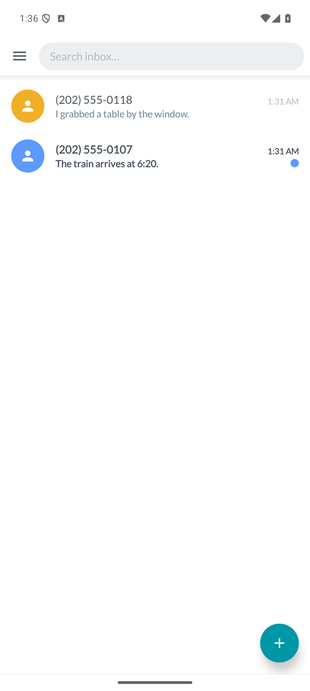
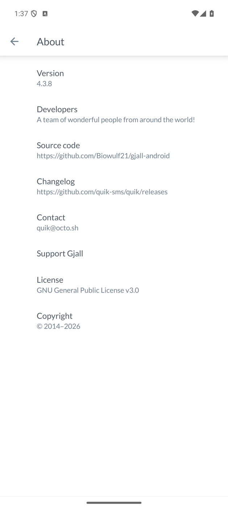

# Gjall

Gjall is an Android SMS and MMS app based on [QUIK](https://github.com/quik-sms/quik), which continues [QKSMS](https://github.com/moezbhatti/qksms). It appears as **Messages** in the launcher.

  

## Install and use

Gjall runs on Android 6 or later and uses the app ID `io.github.biowulf21.gjall`. Install a signed APK, open **Messages**, and choose it as your default SMS app when Android prompts you. Sending and receiving messages depends on your carrier and device configuration.

Open a conversation to send texts, attachments, or voice messages. You can schedule sends, pin or archive threads, configure inbox swipe actions, and back up messages from settings.

## Build

Install JDK 17 and Android SDK 34. Run `./gradlew :presentation:assembleDebug` for a debug APK. Outputs appear in `presentation/build/outputs/apk/`.

To build a signed release, set `GJALL_KEYSTORE` to the absolute keystore path, `GJALL_KEY_ALIAS` to the signing alias, and `GJALL_SIGNING_PROPERTIES` to a private properties file containing `storePassword` and `keyPassword`. Run `./gradlew :presentation:assembleRelease`. Use the original key to update an installed copy.

## Support and credits

[Buy me a coffee](https://buymeacoffee.com/biowulf21), or open **Settings → About → Support Gjall**. Report fork-specific issues on this repository’s Issues page. Include the Gjall version, Android version, and steps to reproduce the issue. Keep phone numbers and message content out of reports.

Thanks to Marcos Jones and the [QUIK contributors](https://github.com/quik-sms/quik/graphs/contributors), Moez Bhatti and the [QKSMS contributors](https://github.com/moezbhatti/qksms/graphs/contributors), and Jake and Luke Klinker for [android-smsmms](https://github.com/klinker41/android-smsmms).

## License

[GNU General Public License v3 or later](LICENSE). See [THIRD_PARTY.md](THIRD_PARTY.md) for notices covering the bundled messaging sources.
