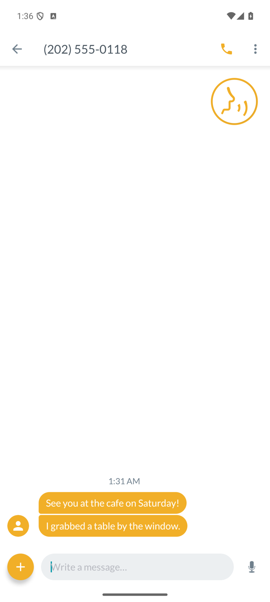

# Gjall

Gjall is an Android SMS and MMS app based on [QUIK](https://github.com/quik-sms/quik), which continues [QKSMS](https://github.com/moezbhatti/qksms). It appears as **Messages** in the launcher.

  

## Install and use

Gjall runs on Android 6 or later and uses the app ID `io.github.biowulf21.gjall`. Install a signed APK, open **Messages**, and choose it as your default SMS app when Android prompts you. Sending and receiving messages depends on your carrier and device configuration.

Open a conversation to send texts, attachments, or voice messages. You can schedule sends, pin or archive threads, configure inbox swipe actions, and back up messages from settings.

## Build

Install JDK 17 and Android SDK 34. Run `./gradlew :presentation:assembleDebug` for a debug APK. Outputs appear in `presentation/build/outputs/apk/`.

To build a signed release, set `GJALL_KEYSTORE` to the absolute keystore path, `GJALL_KEY_ALIAS` to the signing alias, and `GJALL_SIGNING_PROPERTIES` to a private properties file containing `storePassword` and `keyPassword`. Run `./gradlew :presentation:assembleRelease`. Use the original key to update an installed copy.

## Fork and attribution

Gjall is a fork of [QUIK](https://github.com/quik-sms/quik) by Marcos Jones and
contributors, which continues [QKSMS](https://github.com/moezbhatti/qksms) by Moez
Bhatti and contributors. Both are GPL-3.0. The bundled `android-smsmms` module is
by Jake and Luke Klinker and the Android Open Source Project (Apache-2.0). Gjall
uses its own name, icon and app ID and is not affiliated with or endorsed by QUIK
or QKSMS. Upstream copyright headers are kept in every file they cover.

Report fork-specific issues on this repository’s Issues page. Include the Gjall
version, Android version, and steps to reproduce the issue. Keep phone numbers and
message content out of reports.

## Donations

Gjall is free and will stay free: no ads, no paid tier, no in-app purchases. If it
helps you, you can [buy me a coffee](https://buymeacoffee.com/biowulf21) or open **Settings → About → Support Gjall**.
Donations are optional, unlock nothing, and don't buy support or a warranty. You can also support [QUIK](https://github.com/quik-sms/quik) directly.

## Documentation

[PRD.md](PRD.md) · [PRODUCT.md](PRODUCT.md) · [SCHEMA.md](SCHEMA.md) ·
[DESIGN.md](DESIGN.md) (the design language shared by all of Biowulf21's apps)

## License

[GNU General Public License v3 or later](LICENSE). Modified files carry their
original QKSMS/QUIK notices. See [THIRD_PARTY.md](THIRD_PARTY.md) for the
Apache-2.0 and W3C notices covering the bundled messaging sources.
