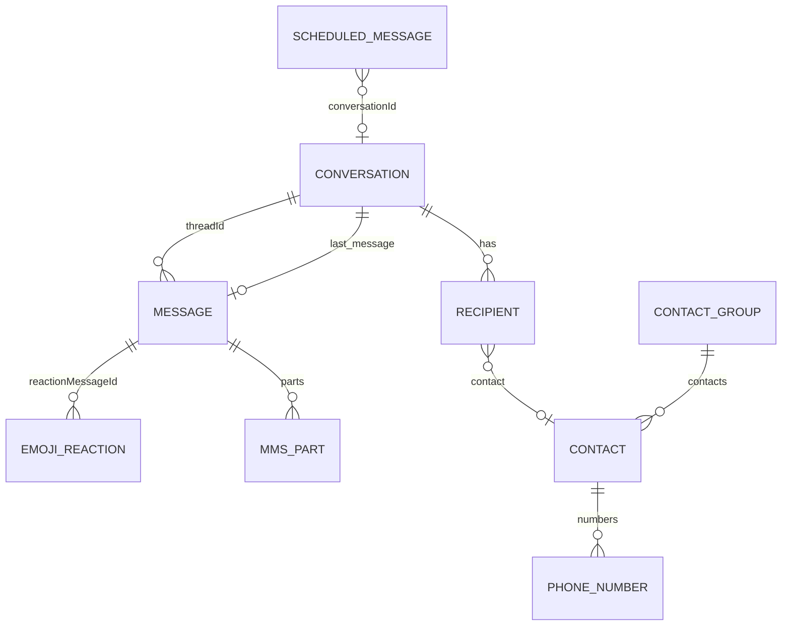

# Gjall Data Schema

**Source of truth:** `domain/src/main/java/com/moez/QKSMS/model/` (Realm models)
and `data/src/main/java/com/moez/QKSMS/migration/QkRealmMigration.kt`
**Realm schema version:** 15
**Package note:** source paths still use upstream's `com/moez/QKSMS` folders while
the Kotlin package is `dev.octoshrimpy.quik`; the app ID is `io.github.biowulf21.gjall`.

This document describes the schema implied by the committed models and
migration. It is not a dump of any device's database.

## 1. Data ownership

| Store | Owner | Contents |
|---|---|---|
| Android Telephony provider (`content://sms`, `content://mms`) | Android | Every SMS/MMS message and thread. **Source of truth.** |
| Android Contacts provider | Android | Names, numbers, photos. Read-only for Gjall. |
| Realm (`Conversation`, `Message`, `MmsPart`, `Recipient`, `Contact`, `PhoneNumber`, `ContactGroup`) | Gjall | Cache/index of the two providers, rebuilt by a full sync |
| Realm (`ScheduledMessage`, `BlockedNumber`, `MessageContentFilter`, `EmojiReaction`, `EmojiSyncNeeded`, `SyncLog`) | Gjall | Gjall-only data; lost on uninstall unless backed up |
| RxSharedPreferences (`Preferences.kt`) | Gjall | Settings: theme colour (`theme`, `theme_<recipientId>`, default `#0097A7`), night mode, black theme, swipe actions, blocking client, launcher label |
| Backup files (`BackupFile`) | User | JSON exports of messages at a location the user picks |

## 2. ERD

`threadId`, `reactionMessageId` and `conversationId` are logical links (plain
`Long` ids), not Realm relationships.

## 3. Model catalog

| Model | Primary key | Fields and notes |
|---|---|---|
| `Conversation` | `id` (= Telephony thread id) | indexed `archived`, `blocked`, `pinned`; `recipients`; `lastMessage`; `draft`, `draftDate`; `blockingClient`, `blockReason`; custom `name`; `sendAsGroup`. Derived: `date`, `snippet`, `unread`, `me` |
| `Message` | `id` | indexed `threadId`; `contentId` (provider row id); `address`; `boxId`; `type` (`sms`/`mms`); `date`, `dateSent`; `seen`, `read`, `locked`; `subId`; `body`; `errorCode`, `deliveryStatus`; attachment type; MMS delivery/read report, `errorType`, `messageSize`, `messageType`, `mmsStatus`, `subject`; `parts` → `MmsPart` |
| `MmsPart` | `id` | indexed `messageId`; MIME `type`; `seq`; `name`; `text`; back-link `messages` |
| `Recipient` | `id` | `address`; optional `contact`; `lastUpdate` |
| `Contact` | `lookupKey` | `numbers`; `name`; `photoUri`; `starred`; `lastUpdate` |
| `PhoneNumber` | `id` | `accountType`; `address`; `type`; `isDefault` |
| `ContactGroup` | `id` | `title`; `contacts` |
| `ScheduledMessage` | `id` | `date` (epoch ms); `subId`; `recipients` (addresses); `sendAsGroup`; `body`; `attachments` (URI strings); `conversationId` for inline display in the thread |
| `BlockedNumber` | `id` | `address` |
| `MessageContentFilter` | `id` | `value`; `caseSensitive`; `isRegex`; `includeContacts` |
| `EmojiReaction` | `id` | indexed `reactionMessageId`, `threadId`; `senderAddress`; `emoji`; `originalMessageText` |
| `EmojiSyncNeeded` | — | `createdAt`; marker that reactions must be re-parsed |
| `SyncLog` | — | `date` of the last sync |

Non-persisted value types: `Attachment` (URI + MIME), `BackupFile` (date, message
count), `SearchResult`.

## 4. Invariants

- A full sync (`SyncRepositoryImpl`) can delete and rebuild every cache model.
  Gjall-only models must never be cleared by it.
- Message bodies and addresses must not be written to logs.
- Every model change bumps `QkRealmMigration.SCHEMA_VERSION` and adds a migration
  step; the migration checks it reached the declared version.
- Units: all timestamps are epoch milliseconds.

## 5. Migration rules

1. Change the model in `domain/.../model/`.
2. Increment `SCHEMA_VERSION` and add the step in `QkRealmMigration.migrate`.
3. Install the previous release, add data (including a scheduled message and a
   content filter), upgrade, and confirm nothing was lost.
4. Update this document in the same commit.
